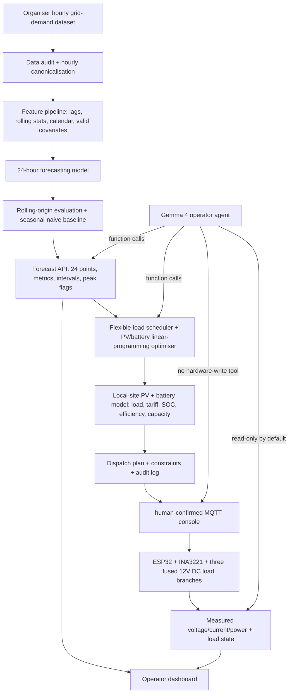

# System architecture

## Design rule

Keep three layers separate:

- **Forecasting layer:** statistical/ML model produces numbers.
- **Decision layer:** deterministic optimisation / scenario code proposes actions under explicit constraints.
- **Language layer:** Gemma 4 explains results and invokes approved tools.

The language model never calculates the official forecast, invents energy savings, or bypasses protection logic. The human-operated MQTT console and firmware are separate from the Gemma tool surface.

## Interfaces

- Dataset adapter -> canonical hourly `timestamp,demand` series.
- Forecast API -> JSON list of 24 hourly values plus model metadata and evaluation metrics.
- Scenario API -> schedule, estimated cost/demand deltas, and assumptions.
- HIL telemetry -> measured DC voltage/current/power, load state, interlock state and fault flags.
- Agent tools -> small allow-list over the above APIs.
